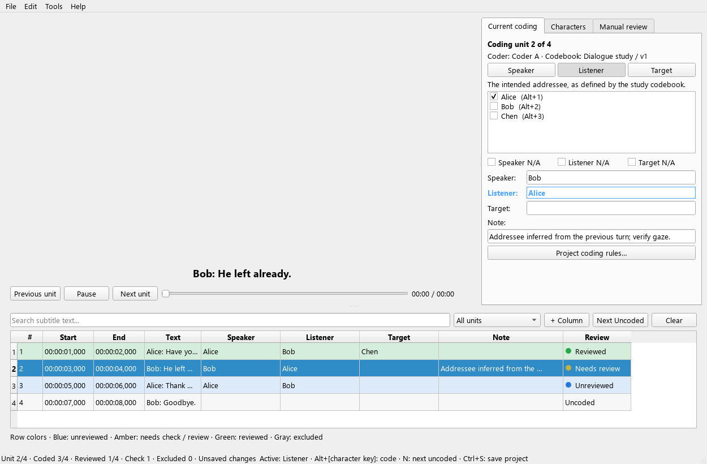

# CIGA Annotator

**CIGA Annotator** is a subtitle-centric video annotation tool with an Aegisub-like layout and mouse and keyboard coding workflow, designed for annotating character interactions (Speaker, Listener, Target).

*This tool is part of the [CIGA (Character Interaction Graph Analysis)](https://github.com/MediaCompLab/ciga) project suite. The CSV exported from this annotator can be directly used in the CIGA library or [CIGA-GUI](https://github.com/MediaCompLab/ciga-gui).*

## Features

- **Aegisub-like layout:** Video + coding panel on top, clickable subtitle list at the bottom.
- **Task-focused right panel:** Current coding, character management and Manual review have separate tabs. Click the video to return to coding.
- **Three-way coding:** Code Speaker, Listener, and Target per subtitle line.
- **Keyboard-first workflow:**
   - `Space`: play/pause and continue line-by-line
   - `Up` / `Down`: previous / next subtitle line
   - `N`: jump to next uncoded subtitle unit; written but unreviewed units are skipped
   - `Left` / `Right`: rewind/forward 2 seconds
   - `Ctrl+F`: focus subtitle search box
   - `F1`: open shortcut help
   - `Ctrl+1 / 2 / 3`: set active coding role to Speaker / Listener / Target
   - `Ctrl+Q`: cycle active coding role
   - `Alt + key`: toggle character in active coding role
   - `Ctrl+N`: edit the blank Name cell to add a character
   - `Ctrl+Shift+N`: open Manual review and find the next unreviewed unit
   - `Ctrl+Return`: mark reviewed and next, available only in Manual review
- **Mouse coding:** Click Speaker/Listener/Target, then check characters. Use explicit N/A when a role does not apply.
- **Character management:** Add, rename and delete controls; immutable identities survive renaming. Referenced characters cannot be deleted.
- **Clickable subtitle list:** Click any row to jump to that line and restore its coding state.
- **Passive review feedback:** Whole subtitle rows show Uncoded, Unreviewed, Needs check/review, Reviewed or Excluded, using colors plus text and a status dot. Missing roles and inherited values never interrupt coding.
- **Separate manual review:** Code continuously with the existing shortcuts and Space advance, then inspect units in Manual review. Required-role and N/A rules are checked only when marking a unit reviewed. Coding edits or rule changes require review again.
- **Separate progress:** Coded and Reviewed counts are independent; recording coding does not imply validation. Only reviewed units enter the reviewed analysis export.
- **Research records:** Project-local coder ID, codebook version, material/unit identities and timestamped coding history.
- **Coding undo/redo:** Undo selections, notes, N/A, review states and adjudication.
- **Independent coder comparison:** Verify matching subtitle and video content and rules, inspect differences, and record an explicit resolution.
- **Editable Note column:** Fill per-line notes either from right panel Note input or directly in the table.
- **Player controls:** Built-in play/pause button, timeline slider, and current/total time display.
- **Coding template options:** Optional inheritance of Listener/Target from the previous line.
- **Autosave + restore:** Every 15 seconds unsaved work is copied to a hidden recovery file (`.<name>.autosave.vat`) next to the project, or next to the subtitles before the first save. Your project file is only written when you save. After a crash, the next session offers to restore the recovery file.
- **Unsaved-change protection:** Save/discard/cancel prompt when closing. Choosing not to save discards the changes and the recovery file.
- **Safer writes:** Manual save and autosave use atomic write replacement to reduce data corruption risk.
- **CSV import/export:** Save and load annotation progress in UTF-8 BOM CSV.
  Repeated imports preserve a single set of table edit handlers, and bulk updates
  do not trigger edit callbacks while cells are being replaced.
  Exports include a numeric `position` column containing the original subtitle order
  (starting at 1), alongside the existing subtitle time strings and role columns.
  CIGA GUI can select these columns automatically; skipped uncoded subtitles retain
  gaps in their position values. CSV import accepts both older exports and this schema.

**Screen shot**


Shown with synthetic subtitle material; video decoding is not part of this screenshot.

## Installation

1. **Clone the Repository**  
   ```
   git clone https://github.com/MediaCompLab/ciga-annotator.git
   cd ciga-annotator
   ```

2. **Install Dependencies** 
   ```
   pip install -r requirements.txt
   ```

## Getting Started

1. **Run the Application** (from the repository root)
   ```
   python run.py
   ```

   If you are on Windows and get a Qt DLL load error in a Conda terminal, run with your system Python explicitly, for example:
   ```
   c:/python313/python.exe run.py
   ```

2. **Select Files**  
   Select your video and SRT files. Character file is optional; see `characters.example.txt`.
   If provided, each line can be:
   - `CharacterName`
   - `CharacterName,ShortcutKey`

   Character names cannot contain commas, because commas separate characters in the exported CSV
   and in CIGA's input. Character files are starting templates; edits are kept in the project
   and do not overwrite a shared template. Use File → Export Character Template to reuse a list.

3. **Start Annotation**  
   Click "Start Annotation" to begin. The player auto-pauses at subtitle boundaries for coding.

4. **Manage Characters**
   Open the Characters tab and use Add/Rename/Delete, or double-click a Name or Key cell.
   Press `Ctrl+N` to add a character in its blank Name row. Enter saves the name and
   continues to the next blank row. Click the video to finish editing and resume
   coding shortcuts; the character table will not take focus back. Clicking a
   read-only Speaker/Listener/Target summary also keeps coding shortcuts available.

5. **Save Progress**
   - Manual save: `Ctrl+S`
   - Open an existing project: File → Open Project
   - Autosave is performed periodically and can be restored automatically.

## Research coding workflow

See [the research workflow and migration guide](docs/research-workflow.md) for completion rules, export choices, coder comparison and research record limits.

## Efficient Coding Workflow

1. Use `Up` / `Down` to move between subtitle lines.
2. Click a role button, or use `Ctrl+1/2/3` / `Ctrl+Q`.
3. Check characters or use `Alt + character key`; mark N/A for inapplicable roles.
4. Press Space at the subtitle boundary to continue; missing roles and review status do not block navigation. Review colors remain visible in the subtitle list.
5. Inheritance offers visible, unconfirmed Listener/Target suggestions. Verify them before confirming.
6. Use `N` / Next Uncoded to find untouched units. After coding, open Manual review and inspect units with Mark reviewed & next or Ctrl+Return. Save with Ctrl+S; CSV export does not save the project.

## Development

```
pip install -r requirements-dev.txt
python -m pytest
```

To build the Windows executable: `python build.py`.
The executable is written to `dist/CIGA-Annotator.exe`; `dist/build-info.json`
records the CSV schema and Python/Qt versions used by the build.
Both applications' build scripts isolate DLL discovery from unrelated PATH tools
such as Conda or Poppler. Qt hooks collect the modules and multimedia plugins used
by the annotator.

## Contributing

Contributions are welcome! To contribute:

1. **Fork the Repository**
2. **Create a New Branch**  
   Run: git checkout -b feature/YourFeatureName
3. **Make Your Changes**
4. **Commit Your Changes**  
   Run: git commit -m "Add Your Feature Description"
5. **Push to Your Fork**  
   Run: git push origin feature/YourFeatureName
6. **Create a Pull Request**

Please ensure your code follows the project's coding standards and includes appropriate documentation.

## License

This project is licensed under the GPL-3.0 License.

