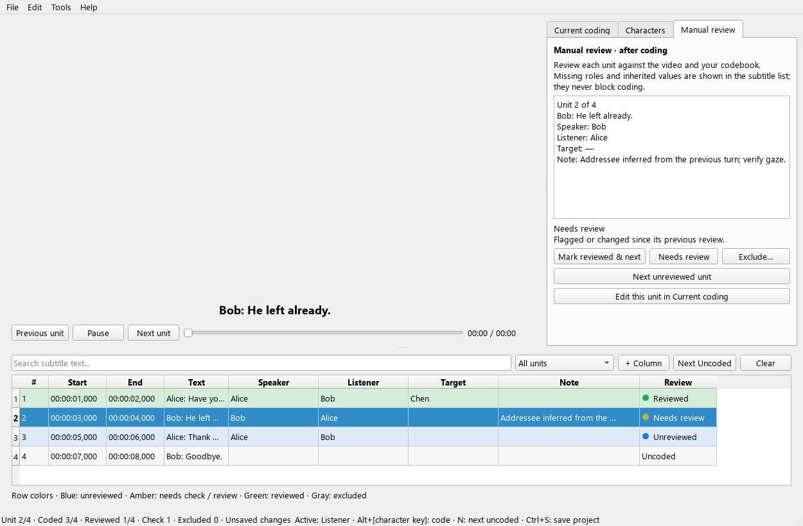

# Research coding workflow (1.1.1)

## Prepare the study

Open the video and SRT files by browsing or pasting existing paths. Coding units are subtitle cues: segmentation must be prepared before coding. The tool does not split or merge video intervals.

In **Project coding rules**, enter the coder ID, codebook version, and each role’s operational definition, examples and ambiguous cases. Speaker/Listener/Target meanings are decided by the study. Choose required roles; the default requires all three. Metadata fields may be left blank, but the application displays “not set” and the record then has no named coder/codebook attribution.

Save a baseline project and give each independent coder a separate copy. Set each copy’s coder ID before coding. Character IDs persist across copies; character names remain in CIGA-compatible exports.

## Code continuously

Select a role button and check characters, or use the original Ctrl+1/2/3 and Alt + character key shortcuts. Space still pauses/plays and advances at the subtitle boundary. Up/Down still navigate units. No confirmation, rule-resolution step or review dialog is required to continue coding, even if roles are missing or inherited. N/A remains available, but required-role validation is deferred to manual review.

**N / Next Uncoded** finds units with no coding content. Any recorded role selection, explicit N/A, note or custom coding value counts as coding content, even when it still needs review. Reviewed and Excluded units are also skipped. If content is completely cleared, the unit becomes eligible for coding again. Finding no uncoded units shows a non-modal message; it does not cycle back through written but unreviewed units.

The subtitle list provides passive feedback, without modifying review metadata merely because a role is missing:

| Display | Color | Meaning |
|---|---|---|
| Uncoded | Default | No coding content recorded |
| Unreviewed | Blue | Content recorded, not manually approved |
| Needs check | Amber | Missing required roles or unverified inherited values |
| Needs review | Amber | Explicitly flagged, adjudicated, edited after review, or affected by changed rules |
| Reviewed | Green | Manually approved under current rules |
| Excluded | Gray | Excluded with a recorded reason |

Each row also shows text, tooltips with the issue, and a color dot that stays visible when the selected-row highlight masks the background. Color alone is not required to interpret status.

Coded and Reviewed progress are separate. A Coded count measures recorded content, not its completeness or correctness. Exclusions are shown separately and removed from the coding/review denominators. Required roles and missing data never turn into a navigation gate.

The Characters tab has Add/Rename/Delete. Names must be unique and contain no commas. Renaming updates all role references and preserves identity and old names as aliases. Deleting an in-use character is blocked with the affected unit count. Templates are not overwritten automatically; export one explicitly if needed.

Click the video or a role button to return to coding after editing characters. Text fields accept typing normally. Shortcut help uses the actual configured keys; Preferences rejects conflicting or reserved shortcuts.

## Review after coding

Open the **Manual review** tab to inspect the current unit, or use **Ctrl+Shift+N / Next unreviewed unit** to find the next unit that has not been reviewed or excluded. This queue also includes uncoded units so a reviewer can catch skipped material. Viewing units in Manual review never creates inherited coding. Clicking the video keeps the review tab open for replay.

The review tab shows recorded roles/notes, the issue details, and Mark reviewed & next, Needs review, Exclude and Edit controls. To change coding, use Edit this unit in Current coding; return to Manual review afterwards.

**Mark reviewed & next / Ctrl+Return** explicitly approves a unit, records its time/coder/codebook and finds the next unreviewed unit, including units already coded. Ctrl+Return is disabled outside Manual review, so the normal coding keyboard loop cannot accidentally approve units.

Only at this approval step does every required role need a selection or explicit N/A. Optional roles may remain empty. A role cannot contain selections and be N/A at the same time. Missing information is explained in the review tab; you can inspect another unit without resolving it immediately. Exclude requires a reason and preserves the record. Editing excluded or reviewed coding sends it back for review.

Older filled-role projects migrate as unreviewed, never as manually approved. Inherited Listener/Target values remain suggestions until a reviewer verifies them. Filtering Uncoded is separate from filtering Coded, not reviewed / Needs check or review.

## Protect and correct records

Each coding edit immediately updates its subtitle row, marks the project unsaved and becomes eligible for the 15-second crash-recovery copy. The title and status bar show unsaved changes. Recovery-copy feedback is separate from explicit project save.

Ctrl+S writes the project atomically. CSV export never marks the project saved. Closing offers save/discard/cancel. Recovery copies are removed after explicit save or discard.

Edit → Undo Coding / Redo Coding restores coding selections, notes, N/A, review states and adjudication. The in-session history contains up to 200 edits; continuous note typing is one edit, with navigation/save boundaries. Rename/delete, project-rule changes and CSV replacement clear this undo history to avoid restoring stale names or rules. The persistent audit log still records these changes, including undo/redo. Undo history is not restored across application restarts.

Tools → Material and Coding History displays project metadata and timestamped records. Times are UTC. This is a local research log, not a cryptographically protected or tamper-proof audit system.

## Export and import

- **Export Reviewed Coding for Analysis:** exports only manually reviewed units, using CIGA’s standard `line,position,start_time,end_time,speakers,listeners,targets` and custom fields. Excluded and unreviewed units do not enter this export; original numeric positions retain gaps.
- **Export All Coding to CSV:** exports every cue, including pending/excluded units, and adds unit/material IDs, review state, N/A, coder/codebook, confirmation and rules. Use for inspection or exchange, not as the final analysis sample.
- **Save Project (.vat):** preserves characters/IDs, rules, full annotations, material metadata and audit history. CSV is not a substitute for this research record.

CSV import replaces current coding after a dialog warning. It validates the complete file before replacing any data: material/text, timestamps/position, duplicate units, N/A and state metadata. Standard older CSV files remain supported and require explicit confirmation. Confirmed metadata is retained only when the material/unit and project rules match and required-role checks pass; otherwise it returns to Needs review. The persisted `review_state` keys remain unchanged (`pending`, `in_progress`, `confirmed`, `needs_review`, `excluded`); Reviewed is the UI label for `confirmed`. Version 1.1.0 uses the same schema, with a different coding/review navigation workflow. CSV import starts a new undo history and adds an import event.

N/A means no selected character for that role. It is exported as an empty role cell, not as an invented character named N/A. CIGA analyses needing interaction edges still require selected characters in their source/target columns.

## Compare independent coders

Tools → Compare Another Coder’s Project checks the parsed subtitle content hash, coding unit IDs, definitions, required roles, custom-field schema and codebook version. Both project videos are read to verify their actual SHA-256 content, with a cancelable progress indicator; comparison fails if the video bytes differ or no longer match a recorded digest. Renamed character identities are matched by ID; independently created projects can match unique, identical names. No fuzzy name matching is used.

Inspect role sets, N/A, review states, notes, custom fields and exclusions side by side. Show unit navigates to the video without creating inherited coding. Keep current / Use other records the source project, source coder and decision, leaves the result in Needs review and supports undo. Confirm the result after adjudication. The other coder’s file is never modified.

This workflow does not calculate inter-coder reliability statistics or provide real-time shared editing. Independent originals should be retained separately from an adjudicated project.

## Existing projects and material changes

Version 1.1.1 opens older .vat projects and adds schema version 2 metadata in memory, marked unsaved. Save As is recommended for an upgraded copy. Releases before 1.1.0 can lose research metadata or misinterpret approval; do not use them to edit the upgraded research copy. The analysis CSV remains compatible with CIGA 0.1.5 and CIGA GUI 1.0.2.

Subtitle IDs hash parsed cue times and text, so file moves, encoding and newline changes do not change identity. Changed subtitle content or an unexpected video size is rejected when opening a recorded project. Video content hashes are verified when comparing; ordinary project opening checks video size, not every byte. Changing the material/segmentation requires a new coding baseline rather than silently reassigning old annotations.

Validation uses real Qt widget mouse/key events and synthetic material. Video codec/playback coverage and research-user usability studies are separate from these automated checks.
